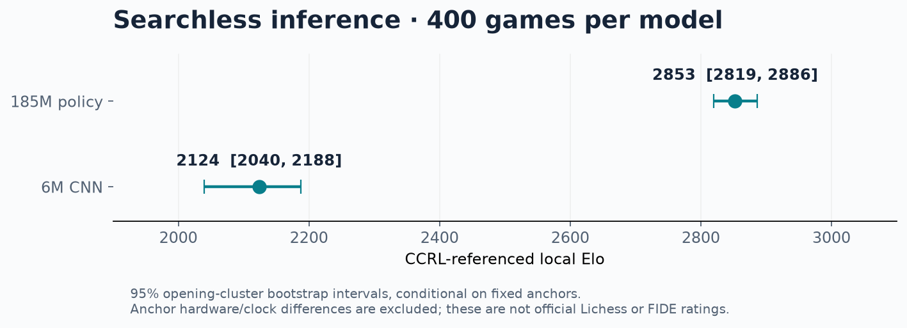

# sonofmagnus

Searchless chess with one neural forward pass per move. The engine reads the board and history, masks illegal moves, and plays. No inference search or online move source.

| Measurement | Result |
|---|---:|
| 185M policy, local engine pool | **2853 Elo** · 400 games · 95% interval 2819–2886 |
| 6M CNN, local engine pool | **2124 Elo** · 400 games |
| Controlled BOT deployment | **2258 blitz** · 172 account games · 492 audited neural moves |
| 185M Metal inference | **17.6 ms p95** isolated; 33.3 ms in games |
| Compact weight-only INT8 ONNX | **6.54 MB · 51.4 ms CPU p95** |

[Measurement details and checksums](results). Local estimates use CCRL-referenced anchors under different clock conditions; they are not official ratings. The deployment account mixes models. These results do not define a combined Elo.



## What we built

- **Legal-move Q distillation.** Stockfish action scores train policy, Q and value heads; held-out boards and puzzle continuations are excluded. A separate human-game pipeline collected **70M positions**.
- **Mixed-precision serving.** Fused Metal attention, weight-only INT8 and lossless ONNX constant packing. A **1,000-game** paired test measured the compact export's FP32 gap at **1.7 Elo**, with an interval spanning zero.
- **Checked deployment.** Model/runtime hashes, retained histories and one-pass counters. **492 neural decisions** were matched to completed server games before publishing these aggregates.

The 185M baseline uses pretrained [LC0 policy weights](ckpts/pretrained.json); it was not trained here on the 70M corpus. Q supervision follows prior work, including [ChessBench](https://github.com/google-deepmind/searchless_chess).

## Run

Python 3.12. The compact model runs on CPU:

```sh
python -m venv .venv
source .venv/bin/activate
pip install -r requirements.txt
python -m scripts.fetch_models 6M
python -m play.uci --ckpt ckpts/sonofmagnus-6M-weight8.onnx
```

For Apple Silicon: `pip install -r requirements-mlx.txt`, then `python -m scripts.fetch_models 185M` and `python -m play.uci --ckpt ckpts/bt4-q6.mlx`.

`pytest -q` runs the tests. `python -m scripts.verify_results` checks the public snapshots. [Data downloaders](data) keep large corpora outside Git; [release models](https://github.com/n33levo/sonofmagnus/releases/tag/v0.2.0) are checksum-pinned. Code is MIT; pretrained weights retain upstream terms.
